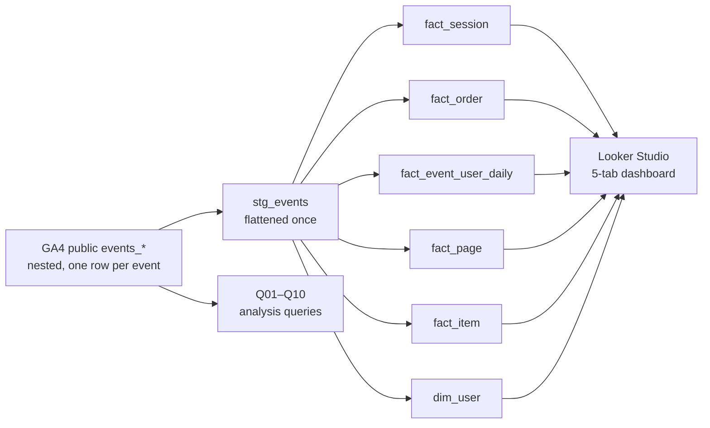

# GA4 eCommerce analysis: SQL + BigQuery + Looker Studio

Analysis of three months of Google Analytics 4 event data from the Google Merchandise Store, using BigQuery SQL on nested GA4 data and a 5-tab Looker Studio dashboard. The aim: find where the store loses customers and revenue, and what to fix first.

**Live dashboard:** _[add your Looker Studio link]_ · **Findings:** [docs/findings.md](docs/findings.md)

---

## Key findings

1. **Payment is the biggest leak in checkout.** 4,290 sessions (39%) stop between shipping and payment. Only 44% of checkouts end in a purchase, and the rate is nearly the same on every device, so the problem is the payment step, not mobile layout.
2. **Two top products have 21,000+ cart adds and zero sales**, which points to a stock or checkout blocker rather than customer choice.
3. **The store's own domain is counted as a "referral" channel.** It shows the highest conversion of any named source, but only 23% of its purchases come from new buyers. These are returning customers credited to the wrong source.
4. **1 in 5 sessions has no usable acquisition source**, so channel ROI can't be judged reliably from this data.
5. **Add-to-cart was barely tracked before mid-November 2020** (4 events against 3,380 product views on 1 Nov). Cart metrics before then are invalid.

Full evidence and recommendations are in [docs/findings.md](docs/findings.md).

## Business questions

| Area | Question | Query |
|---|---|---|
| Overview | Sessions, revenue, AOV, conversion and funnel rates per day | [Q01](sql/analysis/q01_overview_metrics.sql) |
| Tracking | Which user actions does the site track, and how often? | [Q02](sql/analysis/q02_event_types.sql) |
| Acquisition | Which sources and mediums bring the most sessions? | [Q03](sql/analysis/q03_sessions_by_source_medium.sql) |
| Acquisition | Which channels drive views, checkouts, purchases and new buyers? | [Q04](sql/analysis/q04_source_medium_actions.sql) |
| Demographics | Users by device, country, and OS + browser, and which convert best | [Q05](sql/analysis/q05_users_by_device.sql), [Q06](sql/analysis/q06_users_by_country.sql), [Q07](sql/analysis/q07_users_by_os_browser.sql) |
| Engagement | Top pages, landing pages and bounce rate | [Q08](sql/analysis/q08_top_pages.sql) |
| Product | Views, cart adds, checkouts, units and revenue per product; cart abandonment | [Q09](sql/analysis/q09_product_performance.sql) |
| Funnel | Checkout funnel by device, in presence and in-order versions | [Q10](sql/analysis/q10_checkout_funnel_by_device.sql) |

## Data

- **Dataset:** [`bigquery-public-data.ga4_obfuscated_sample_ecommerce`](https://developers.google.com/analytics/bigquery/web-ecommerce-demo-dataset), Google Merchandise Store, 1 Nov 2020 – 31 Jan 2021.
- **Shape:** one row per event, with nested `STRUCT` fields (`device`, `geo`, `traffic_source`, `ecommerce`) and repeated `ARRAY` fields (`event_params`, `items`) that need `UNNEST`.
- **Caveat:** Google anonymised the dataset, so some values are placeholders (`<Other>`, `(data deleted)`, `Web`). See [data-quality notes](docs/metric_definitions.md#data-quality-notes).

## Approach



1. **Explore and answer:** ten standalone queries ([`sql/analysis`](sql/analysis)), each with the brief's answer, optional deeper cuts and QA checks.
2. **Model for the dashboard:** one script ([`sql/dashboard/build_dashboard_tables.sql`](sql/dashboard/build_dashboard_tables.sql)) builds a flat staging table and six fact/dimension tables at clear grains (session, order, page view, product entry, user). It ends with QA checks.
3. **Visualise:** Looker Studio reads those tables. All rates are calculated fields (ratios of sums), so they stay correct under any filter. See the [setup guide](docs/looker_studio_guide.md).
4. **Interpret:** findings written as finding → evidence → recommendation, with confidence levels and data caveats.

## Techniques used

- `UNNEST` on `event_params` and `items`; scalar subqueries to pull a single parameter
- A composite session key (`user_pseudo_id` + `ga_session_id`)
- Window functions: `SUM() OVER` for shares, `LOGICAL_OR() OVER` to flag purchasers in one pass, `ROW_NUMBER()` to flag duplicate transactions, `RANK()`
- Conditional aggregation (`COUNTIF`, `COUNT(DISTINCT IF(...))`) instead of many separate queries
- Ordered funnels with timestamp arrays and step-by-step `MIN(...) WHERE t >= previous_step`
- `ARRAY_AGG(... ORDER BY ... LIMIT 1)` for first-touch attributes (landing page, first device)
- `SAFE_DIVIDE`, placeholder handling, minimum-volume thresholds when ranking rates
- QA and reconciliation queries for every output

## Metric definitions

Where this project departs from the course brief, and why: [docs/metric_definitions.md](docs/metric_definitions.md). In short:
- `traffic_source` is treated as the **first-user** source, not the session source.
- AOV divides by **distinct transactions**, not purchase events.
- The checkout funnel is shown both as the brief's presence funnel and as a strict in-order funnel.

## How to reproduce

1. Create a Google Cloud project and open BigQuery (Sandbox is enough).
2. Run any file in `sql/analysis/` to see one question's answer.
3. Run `sql/dashboard/build_dashboard_tables.sql` to build the dashboard tables in a `ga4_portfolio` dataset, and check the QA output is all `TRUE`.
4. Follow [docs/looker_studio_guide.md](docs/looker_studio_guide.md) to connect Looker Studio and build the 5 tabs.

## Repository structure

```
├── README.md
├── sql/
│   ├── analysis/          Q01–Q10, one file per business question
│   └── dashboard/         build script for the Looker Studio tables
├── docs/
│   ├── findings.md               insights and recommendations
│   ├── metric_definitions.md     definitions, brief vs project, data-quality notes
│   └── looker_studio_guide.md    connection steps, calculated fields, tab layout
└── images/                dashboard screenshots
```

## Dashboard

_Screenshots to add: `images/01_overview.png`, `02_revenue_drivers.png`, `03_demographics.png`, `04_user_behaviour.png`, `05_funnel.png`._

## Limitations and next steps

- No cost data, so channel ROI and paid-search efficiency can't be judged.
- First-user attribution only; newer GA4 exports have session-level source fields.
- Obfuscated values limit OS and channel detail.
- **Next:** RFM segmentation of buyers, a cohort retention chart by first-visit week, and a time-to-purchase analysis.

---

**Andy Tran** · ICT Business Analyst moving into data analytics · Project brief from UniGap's SQL coaching module.
